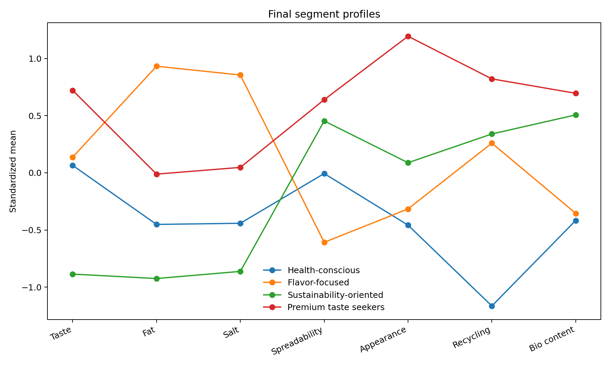
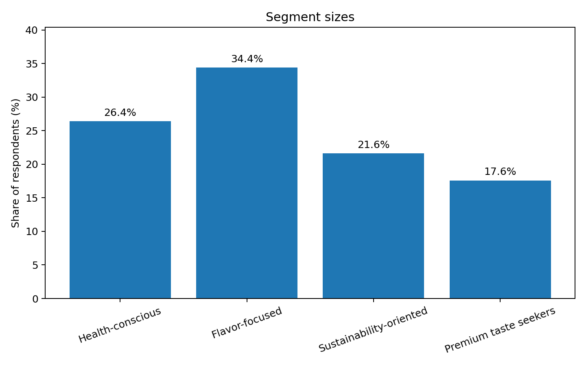
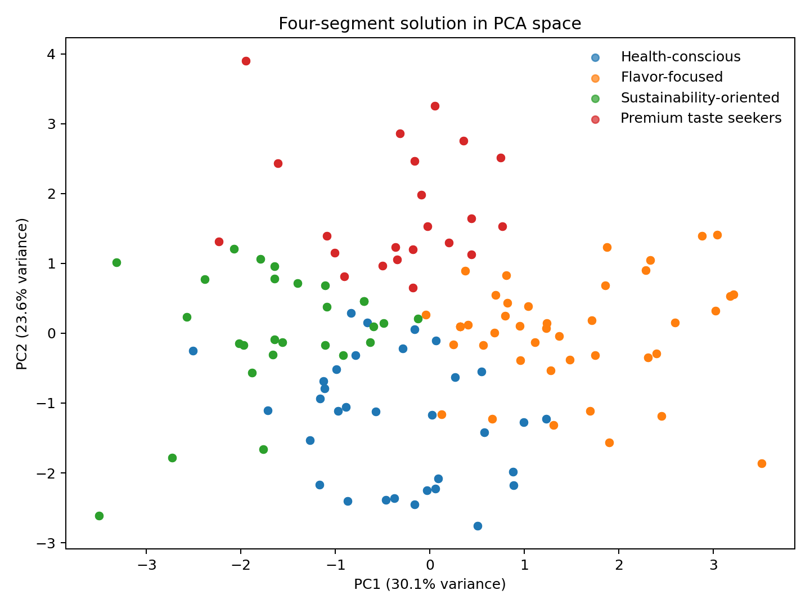

# Consumer Segmentation with Hierarchical Clustering & K-means

This project tests a simple marketing assumption: **does a market that looks like two obvious consumer groups actually break into more useful segments once the preference data is analysed?**

It was an individual university project built around a fictional organic sandwich-spread brand. The case manager expected two main groups — food/taste-oriented consumers and sustainability-oriented consumers — representing roughly 40% of the market.

I used hierarchical clustering, K-means, a combined hierarchical/K-means approach, ANOVA, Tukey post-hoc tests, chi-square tests and PCA to compare possible segment structures.

The final solution contains **four segments**, not two.



## Business question

How many distinct consumer segments exist in the market, what separates them, and how could a fictional organic food brand position itself around those differences?

The dataset contains **500 respondents** and seven active product-preference variables:

- taste
- fattiness
- salt
- spreadability
- appearance
- recycling
- bio-content

Age, gender, education and area of residence are used to profile the clusters after segmentation rather than to create them.

## Approach

I did not choose the number of segments in advance.

1. Explored the survey variables and checked the data structure.
2. Compared Ward, centroid and complete-linkage hierarchical clustering.
3. Used dendrograms and late-stage agglomeration distances to narrow the candidate solutions to **3 and 4 clusters**.
4. Ran K-means for both candidate solutions.
5. Used hierarchical cluster centres as starting values for K-means to make the final comparison less dependent on random starting points.
6. Compared segment profiles with ANOVA and Tukey HSD tests.
7. Used chi-square tests to check whether gender, education and area differed across segments.
8. Used PCA as a visual check of the cluster structure.

The seven preference variables share the same 1–7 scale. In the submitted workflow, the hierarchical stage used the original values, while K-means and segment profiles used standardized values. I preserve that choice here because it reproduces the submitted final solution.

## Final segmentation

The final combined four-cluster solution contains:

| Segment | Share | What stands out |
| --- | ---: | --- |
| **Health-conscious** | 26.4% | Lower fat and salt; relatively weak sustainability emphasis |
| **Flavor-focused** | 34.4% | Strongest preference for fat and salt; weaker bio preference |
| **Sustainability-oriented** | 21.6% | High recycling and bio-content preference; lower taste/fat/salt scores |
| **Premium taste seekers** | 17.6% | High taste, spreadability and appearance scores together with strong recycling/bio preferences |



A useful result is that the manager's rough **40%** estimate was surprisingly close if the closest "sustainability" and "premium/taste" groups are combined: **21.6% + 17.6% = 39.2%**. But the market structure was more nuanced than the original two-segment story, and the demographic assumptions did not consistently match the data.

## What separates the segments?

The profile chart uses standardized means, so zero represents the overall sample average.

- **Cluster 1** is defined mainly by lower fat and salt preferences, but also scores well below average on recycling.
- **Cluster 2** stands out very clearly on fat and salt.
- **Cluster 3** combines stronger sustainability preferences with lower taste, fat and salt scores.
- **Cluster 4** is the most rounded premium-style segment: taste, spreadability, appearance, recycling and bio-content are all above average.

The ANOVA results show meaningful differences across the final clusters for the active product attributes. Tukey HSD tests were then used to see which cluster pairs drove those differences.

## Demographic profiling

I used the demographic variables only after the clusters were created.

Gender and education are associated with final cluster membership, while area of residence is not statistically significant in the final combined solution. The gender and education tables contain some sparse cells, so the chi-square approximation generates warnings and I treat those results as supporting profile information rather than the basis for the segmentation.

The public portfolio version also corrects a few demographic descriptions from the original slide deck by checking them back against the assignment's coding and the final cluster table.

## PCA view

PCA is used here as a **visualisation tool**, not as the clustering method itself. The first two components give a useful two-dimensional view of the final groups, while the clustering still uses all seven active preference variables.



## Commercial interpretation

I would use the segments primarily to guide **positioning and testing**, rather than claim that the survey directly identifies the best media channel.

Examples:

- a low-fat / low-salt proposition is most relevant to the health-conscious group;
- richer taste cues fit the flavor-focused group;
- recyclable packaging and organic sourcing are especially relevant to the sustainability-oriented group;
- a premium proposition combining taste, appearance and ethical cues fits the fourth group.

Ideas such as influencer marketing, specific social platforms or retail-channel changes would still need to be tested separately. The segmentation tells us **what each group values**, not which campaign execution will definitely work.

## Repository structure

```text
consumer-segmentation-cluster-analysis/
├── README.md
├── analysis/
│   └── consumer_segmentation.R
├── data/
│   ├── consumer_preferences.csv
│   ├── segment_summary.csv
│   └── README.md
├── visuals/
│   ├── cluster_profiles.png
│   ├── cluster_sizes.png
│   └── pca_clusters.png
├── ANALYSIS_NOTES.md
├── R-packages.txt
└── .gitignore
```

## Data

The public dataset is the individual-specific course dataset used for this fictional case. I removed my student-number column and renamed the respondent identifier; the preference and demographic values are otherwise unchanged.

The cleaned file contains **500 respondents**, no missing values and no duplicate rows.

## Tools

**R:** `cluster`, `scatterplot3d`, base `stats` and `graphics`

**Methods:** hierarchical clustering, K-means, combined clustering, PCA, ANOVA, Tukey HSD, chi-square tests

## Limitations

- Segment labels are interpretations of cluster profiles, not observed customer identities.
- Different distance measures, scaling choices or clustering algorithms can produce different segment structures.
- PCA compresses seven dimensions into two for visualisation, so overlap in the plot does not by itself invalidate the solution.
- Sparse cells make some demographic chi-square results less reliable.
- The dataset measures preferences and demographics, not actual campaign response. Channel and creative recommendations should therefore be treated as hypotheses to test.

## About the project

This was an **individual** university project. I completed the data exploration, clustering, statistical profiling, interpretation and recommendations myself.

For this portfolio version I kept the original analytical logic and final segment solution, while cleaning file paths, fixing a few implementation mistakes and tightening the distinction between observed results and marketing ideas that would still need testing.
